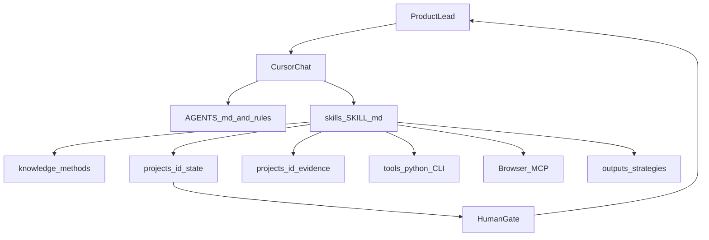

# Архитектура агента «Стратег Фабрики продуктов»

## Идея

Агент = **локальная LLM (Ollama)** + файловый контур (инструкции / методы / материалы / состояние) + sandbox-инструменты в `local_agent/`. Тот же контур открывается в **Cursor** как альтернативный UI. Прогресс = артефакты на диске, не история чата.

Запуск по умолчанию: `python -m local_agent` (данные и инференс на машине). Это не облачный daemon и не OpenClaw: переносимая папка + явный CLI.

## Компоненты

| Слой | Путь | Роль |
|------|------|------|
| Инструкции | `AGENTS.md`, `.cursor/rules/` | поведение, безопасность, workflow |
| Методы | `knowledge/` | JTBD, варианты, стратегии, routing, resilience |
| Процедуры | `skills/*/SKILL.md` | повторяемые фазы |
| Хуки | `.cursor/hooks.json` | напоминание ledger/cost после правок артефактов |
| Инструменты | `tools/*.py` | status, validate, cost, evidence index, tables, baseline |
| Проект | `projects/<id>/` | inputs, evidence, state, outputs |

## Процесс

1. **Intake** — только блокирующие вопросы.  
2. **Gather** — evidence + claims со ссылками.  
3. **Research** — situation (известно / гипотезы / пробелы).  
4. **Options** — ≥3 варианта вкл. status quo и kill/narrow → **human gate**.  
5. **Strategy** — product → communication → validation.  
6. **After** — decisions, обязательства, revise-on-new-data.

## Контекст и память

- Между сеансами: `state/CURRENT.md` + `ledger.md` + `claims.jsonl`.  
- Новый чат: «Прочитай AGENTS.md и CURRENT.md — продолжай».  
- Ответ модели в чате **не** становится фактом без записи в evidence/claims.  
- Устаревшие claims помечаются при revise (не затираются молча).

## Субагенты и routing

См. `knowledge/routing/`. Глубокий проход — для синтеза и стратегии; субагенты — researcher, analyst, critic, comms, ux-reviewer, synthetic respondents.

## Переносимость

Весь прогресс в файлах репозитория. Перенос папки / другой IDE с поддержкой инструкций = продолжение с CURRENT.md.
